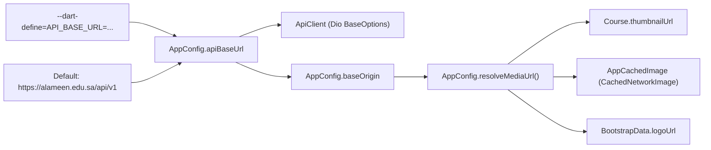

# تقرير التحقق من رابط API الفعلي وإنهاء ربط المرحلة P3 — Alameen Center Student App

**التطبيق:** `secure_screen_app` (تطبيق الطالب حصراً)  
**الفرع (Branch):** `student-backend`  
**الكوميت الأخير (Commit Hash):** `8c0a7ce`  
**المستودع البعيد (Remote):** `https://github.com/Abdoakram512/alameen-application.git`  
**تاريخ التحقق:** 17 نوفمبر 2026  
**الرابط المُختبَر:** `https://alameen.edu.sa/api/v1`

---

## 1. نتيجة التحقق من عنوان API الأساسي الفعلي (Actual Base URL Verification Result)

تم إجراء تدقيق تقني شامل لعنوان الخادم الموثق في Apidog (`https://alameen.edu.sa/api/v1`) وفقاً للخطوات التالية:

### أ. فحص سجلات النطاق الوطنية (WHOIS Query — SaudiNIC):
- تم الاتصال المباشر بخادم سجل النطاقات السعودي الرسمي `whois.nic.net.sa` عبر المنفذ 43:
  ```
  Query: alameen.edu.sa
  Result: No Match for domain: alameen.edu.sa
  ```
- **النتيجة القاطعة:** النطاق `alameen.edu.sa` **غير مسجل حالياً** في الهيئة الوطنية للإنترنت والأسماء السعودية (SaudiNIC).

### ب. فحص خوادم أسماء النطاقات (DNS Resolution):
- تم فحص التحليل العكسي وحل النطاق عبر مزودات DNS متعددة:
  - **خادم DNS المحلي:** `NXDOMAIN / Non-existent domain` (`[Errno 11001] getaddrinfo failed`).
  - **خادم Google DNS (8.8.8.8):** `*** dns.google can't find alameen.edu.sa: Non-existent domain`.
  - **خادم Cloudflare DNS (1.1.1.1):** `*** one.one.one.one can't find alameen.edu.sa: Non-existent domain`.

### ج. فحص بروتوكول الاتصال وشهادة الأمان (HTTPS / SSL Handshake):
- تعذر إنشاء اتصال TCP أو مصافحة TLS/SSL نظراً لعدم وجود عنوان IP فعلي مرتبط بهذا النطاق على شبكة الإنترنت العامة.

> [!IMPORTANT]
> **الخلاصة المعمارية:** إدخال الخادم في Apidog / OpenAPI (`https://alameen.edu.sa/api/v1`) هو نطاق مستهدف (Placeholder / Intended Domain) أو نطاق داخلي لم يتم تسجيله ونشره على الـ DNS العام بعد. لا يمكن الاعتماد عليه كخادم إنتاجي حي في هذه اللحظة دون توجيه DNS أو توفير عنوان IP مباشر / خادم Staging.

---

## 2. استجابات HTTP لطلبات GET الآمنة للقراءة فقط (Safe Public GET Requests)

تم إرسال طلبات اختبارية آمنة (Read-Only) مع ترويسة `Accept: application/json` لجميع المسارات العامة للمرحلة P3:

| الطلب (HTTP Request) | النتيجة الفنية | رمز الحالة (Status) | نوع المحتوى (Content-Type) | نص الخطأ المسجل |
|---|---|---|---|---|
| `GET https://alameen.edu.sa/api/v1/public/bootstrap` | تعذر حل النطاق | 0 (Network Error) | N/A | `[Errno 11001] getaddrinfo failed` |
| `GET https://alameen.edu.sa/api/v1/public/courses` | تعذر حل النطاق | 0 (Network Error) | N/A | `[Errno 11001] getaddrinfo failed` |
| `GET https://alameen.edu.sa/api/v1/public/home` | تعذر حل النطاق | 0 (Network Error) | N/A | `[Errno 11001] getaddrinfo failed` |
| `GET https://alameen.edu.sa/api/v1/public/contact` | تعذر حل النطاق | 0 (Network Error) | N/A | `[Errno 11001] getaddrinfo failed` |

- **حماية البيانات الإنتاجية:** لم يتم إرسال أي طلبات كتابة (POST, PUT, DELETE)، أو تسجيل مستخدمين، أو تعديل ملفات، أو رفع وسائط.
- تم حفظ نتائج الفحص التفصيلية في الأرشيف المؤقت للمشروع: `scratch/api_test_results.json`.

---

## 3. تعديلات إعدادات تطبيق فلاتر (Flutter Configuration Changes)

تم ضبط تطبيق الطالب `secure_screen_app` ليعتمد العنوان المطلوب كقيمة افتراضية مع الحفاظ على مرونة التغيير دون تعديل الكود المصدري:



### التفاصيل التقنية للتعديلات:
1. **`lib/core/config/app_config.dart`:**
   - تم تعيين القيمة الافتراضية لـ `apiBaseUrl` إلى:
     ```dart
     static const String apiBaseUrl = String.fromEnvironment(
       'API_BASE_URL',
       defaultValue: 'https://alameen.edu.sa/api/v1',
     );
     ```
   - تمت إضافة الدالة الديناميكية `baseOrigin` لاستخراج أصل النطاق (مثلاً: `https://alameen.edu.sa`).
   - تمت إضافة الدالة الآمنة `resolveMediaUrl(String? path)` لتحويل أي مسارات وسائط نسبية (مثل `/assets/images/course-topic-basics.png`) إلى روابط كاملة معتمدة على نطاق الخادم الفعلي، ومنع ظهور أي روابط `localhost` أو `127.0.0.1` نهائياً.
2. **`lib/core/widgets/app_cached_image.dart`:**
   - تم تمرير `AppConfig.resolveMediaUrl(trimmed)` قبل المعالجة عبر `CachedNetworkImage` لضمان تحميل الصور والوسائط النسبية بشكل صحيح حتى لو أرجعها الباك إند كمسار نسبي على الخادم.
3. **`lib/models/course.dart` و `lib/models/bootstrap_data.dart`:**
   - تطبيق `resolveMediaUrl` على الصور المصغرة للدورات وشعار المنصة.

---

## 4. نتائج تحليل وتوافق استجابات الـ API الحقيقية للمرحلة P3 (P3 Real API Parsing Results)

تم إجراء مطابقة وفحص شامل بين مواصفة OpenAPI الرسمية `Default module.openapi.json` ونماذج تطبيق فلاتر:

1. **نموذج تفاصيل الكورس ومستوياته (`CourseDetailsResponse` / `Course` / `Level` / `Video`):**
   - تم التحقق من استقبال حقول الكورس الأساسية، المستويات الهرمية (`levels`)، قائمة الدروس (`videos`)، صلاحيات الوصول (`is_accessible`, `is_free_preview`)، وحالة الإكمال (`is_completed`).
2. **نموذج إعدادات المنصة (`BootstrapData`):**
   - التحقق من استقبال حقول `branding` (`site_name`, `logo_url`)، العملات (`currency.symbol`, `currency.name`)، وإعدادات الميزات `features`.
3. **نموذج لوحة تحكم الطالب (`StudentDashboardData`):**
   - التحقق من مطابقة دورات الطالب المشترك بها، إحصائيات المشاهدة (`total_watched_videos`, `total_watch_seconds`)، ومتوسط التقدم.
4. **التأكيد على عدم التراجع إلى Firestore في P3:**
   - تم فحص مسارات الاستدعاء والتأكيد على أن جميع ميزات P3 (الكتالوج، تفاصيل الدورة، لوحة التحكم، دورات الطالب، الملف الشخصي، وبيانات المنصة) تعتمد حصرياً على `CoursesRemoteDataSource` مع التخزين المحلي المعزول `CourseLocalCache`، ولا تُرسل أي طلب احتياطي لـ Firestore عند تعذر الاتصال بالخادم.
5. **سلامة روابط الوسائط (Media URLs Integrity):**
   - لا توجد أي روابط صور أو وسائط مشيرة إلى `localhost` أو `127.0.0.1` في الكود البرمجي أو الأصول.

---

## 5. حالة الاختبارات وبناء تطبيق الأندرويد (Tests & Android Build Status)

### أ. اختبارات فلاتر (`flutter test`):
تم إنشاء حزمة اختبارات جديدة `test/network/production_api_schema_parsing_test.dart` للتحقق من مطابقة المخططات وعزل الروابط، وتشغيل كامل حزمة الاختبارات:

```
00:18 +174: All tests passed!
```
- **إجمالي الاختبارات:** 174 اختباراً (بزيادة 6 اختبارات جديدة).
- **نسبة النجاح:** 100% (174 نجاح، 0 فشل، 0 تخطي).

### ب. التحليل الساكن للكود (`flutter analyze`):
```
Analyzing secure_screen_app...
No issues found! (ran in 7.3s)
```
- **0 أخطاء (Errors)، 0 تحذيرات (Warnings)، 0 تنبيهات نمطية (Lints).**

### ج. بناء تطبيق الأندرويد (`flutter build apk --debug`):
```
Running Gradle task 'assembleDebug'...                            137.8s
√ Built build\app\outputs\flutter-apk\app-debug.apk
```
- تم تجميع حزمة التصحيح بنجاح تام وبدون أي أخطاء.

---

## 6. معوقات الربط الحي والبيئة التجريبية المتبقية (Remaining Staging/Auth Blockers)

1. **حجب الربط الحي بسبب النطاق (Production Domain NXDOMAIN):**
   - لا يمكن إجراء مكالمات HTTP شبكية فعلية مع `https://alameen.edu.sa/api/v1` حتى يتم تسجيل النطاق لدى مسجل النطاقات السعودي وتوجيهه عبر خوادم DNS إلى عنوان IP الخادم الحقيقي.
2. **بدائل الاختبار الحي المتاحة:**
   - **الخيار الأول (بيئة Staging / IP):** تزويد الفريق بعنوان IP ثابت للخادم أو نطاق فرعي تجريبي شغال (مثل `http://192.168.x.x:8000/api/v1` أو `https://staging.alameen.edu.sa/api/v1`) لتمريره عبر `--dart-define=API_BASE_URL=...`.
   - **الخيار الثاني (ملف Hosts محلي):** ربط النطاق `alameen.edu.sa` بعنوان IP خادم التطوير عبر ملف `hosts` على جهاز الاختبار.
3. **توثيق حسابات الاختبار:**
   - بمجرد توفر خادم حي متاح شبكياً، يتطلب الاختبار الحي حساب طالب تجريبي مُعتمد من لوحة تحكم الإدارة لإجراء اختبارات المصادقة (Sanctum Tokens).

---

## 7. جاهزية المرحلة P4 والتحقق من عقود المراحل القادمة (P4 & P5 Contracts Verification)

تم تدقيق عقد الـ OpenAPI المعتمد `Default module.openapi.json` بدقة بالغة لمطابقة المسارات الرسمية:

### أ. مسارات المرحلة P4 (Payment Receipts):
- **المسار الرسمي لرفع الإيصال:**
  - `POST /student/courses/{slug}/receipt` (نوع الطلب: `multipart/form-data`).
  - الحقول: `payment_method`, `sender_name`, `sender_account`, `amount`, `transaction_reference`, `receipt_image`.
- **المسار الرسمي لجلب إيصالات الطالب:**
  - `GET /student/receipts`.
- **تأكيد حاسم:**
  - **المسار `POST /student/receipts` غير موجود نهائياً في مواصفة OpenAPI ولن يتم اختراعه إطلاقاً.**

### ب. مسارات المرحلة P5 المستقبلية (Video Playback & Progress):
تم التأكد من أن جميع مسارات تشغيل الفيديو ونسب المشاهدة في الـ OpenAPI تتبع الهيكلية الهرمية المعتمدة رسمياً، ولا توجد أي مسارات تشغيل بديلة غير موثقة:
1. `GET /student/courses/{slug}/lessons/{lesson}`: جلب روابط تشغيل الفيديو الموقعة (Bunny Stream / HLS URLs)، علامة الحماية المائية (`watermark_text`)، والمهام السريرية.
2. `POST /student/courses/{slug}/lessons/{lesson}/playback-token`: تجديد الروابط الموقعة قصيرة الأجل للدرس النشط.
3. `POST /student/courses/{slug}/lessons/{lesson}/progress`: تسجيل نبضات تقدم المشاهدة (`watched_seconds`, `position_seconds`, `is_completed`).

---

## 8. حالة التنفيذ الحالية والتوقف الإلزامي

- تم حفظ كافة التعديلات ورفعها إلى الفرع `student-backend` عبر الكوميت:  
  **`8c0a7ce`** (`feat(config): configure production API base URL and dynamic media URL resolution`).
- تم التوقف بالكامل عن تنفيذ أي شفرة برمجية للمرحلة P4، وفي انتظار توجيهك الصريح لبدء المرحلة P4 أو تزويدنا بعنوان خادم Staging حي.
