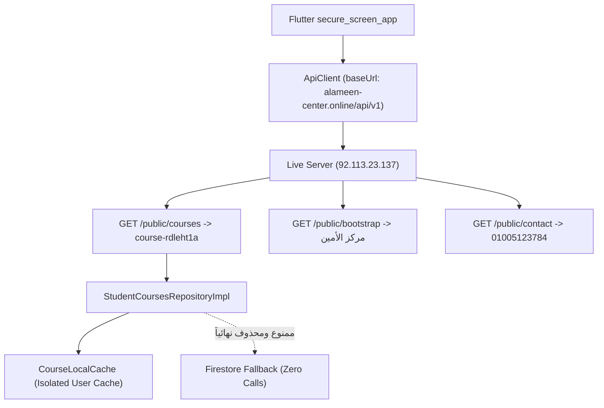

# تقرير تصحيح نطاق API والتحقق الحي مع خادم الإنتاج الحقيقي — Alameen Center Student App

**التطبيق:** `secure_screen_app` (تطبيق الطالب حصراً)  
**الفرع (Branch):** `student-backend`  
**الكوميت الأخير (Commit Hash):** `2942a38`  
**المستودع البعيد (Remote):** `https://github.com/Abdoakram512/alameen-application.git`  
**تاريخ التحقق:** 17 نوفمبر 2026  
**عنوان API المعتمد الفعلي:** `https://alameen-center.online/api/v1`  
**التوثيق المباشر:** `https://alameen-center.online/api/v1/docs`  
**مواصفة OpenAPI الحية:** `https://alameen-center.online/api/v1/openapi.json`

---

## 1. عنوان واجهة برمجة التطبيقات الأساسي المصحح (Corrected API Base URL)

تم تصحيح وتحديث عنوان الخادم في تطبيق الطالب بالكامل وإلغاء النطاق القديم غير المسجل (`alameen.edu.sa`):

- **العنوان الأساسي للإنتاج (Default Production Base URL):**  
  `https://alameen-center.online/api/v1`
- **أصل النطاق لحل الوسائط (Media Origin):**  
  `https://alameen-center.online`
- **مرونة البيئة (Environment Flexibility):**  
  تم الحفاظ الكامل على إمكانية التمرير الديناميكي عبر معلمة سطر الأوامر `--dart-define=API_BASE_URL=...`.
- **سلامة التوجيه:**  
  لا توجد أي طلبات موجهة إلى `localhost` أو `127.0.0.1` أو النطاق القديم.

---

## 2. التحقق من مواصفة OpenAPI الحية ومقارنتها (Live OpenAPI Verification)

تم سحب مواصفة OpenAPI مباشرة عبر الإنترنت من خادم الإنتاج الحي:  
`GET https://alameen-center.online/api/v1/openapi.json` (الحجم: **123,940 بايت** — 200 OK).

### مقارنة المواصفة الحية بالملف القديم (`Default module.openapi.json`):
1. **المسارات والعمليات:**  
   كلا الملفين يتطابقان في **64 مساراً (Paths)** و **15 مخططاً أساسياً (Components/Schemas)**.
2. **الفروقات الدقيقة المكتشفة في المسارات:**
   - `POST /student/settings/profile` و `PUT /student/settings/profile`: وثقت المواصفة الحية صراحة حقول: `['name', 'email', 'phone', 'address', 'city', 'country', 'locale']`.
   - `POST /student/assignments/{task}/submit`: وثقت المواصفة الحية صراحة حقول: `['audio_base64', 'student_notes', 'duration_seconds']`.
3. **تدقيق ميزات المراحل القادمة (P2, P3, P4, P5):**
   - **Google Sign-In (`POST /auth/google/token`):** متطابق تماماً، يستقبل `access_token` و `device_name`.
   - **اعتماد الحسابات (`/auth/me`):** يعيد حالة الطالب `active` أو `pending` أو `suspended`.
   - **رفع إيصالات الدفع (P4):** المسار الوحيد المعتمد هو `POST /student/courses/{slug}/receipt` عبر `multipart/form-data` بالحقول: `['payment_method', 'sender_name', 'sender_account', 'amount', 'transaction_reference', 'receipt_image']`.
   - **شراء المستويات الفردية (P4 Individual Level Purchases):** المواصفة الحية في الباك إند **لا تدعم حقل `level_id` إطلاقاً** في رفع الإيصالات.
   - **تشغيل الفيديو ونسب المشاهدة (P5):** المسارات المعتمدة حصراً هي:
     - `GET /student/courses/{slug}/lessons/{lesson}` (روابط التشغيل الموقعة و `watermark_text`).
     - `POST /student/courses/{slug}/lessons/{lesson}/playback-token` (تجديد الروابط الموقعة).
     - `POST /student/courses/{slug}/lessons/{lesson}/progress` (تسجيل نبضات المشاهدة).

---

## 3. نتائج اختبار نقاط النهاية العامة الحقيقية (Public Endpoint Test Results)

تم تنفيذ طلبات شبكية فعلية وحية (Real Live HTTP Requests) ضد `https://alameen-center.online/api/v1`، وجاءت كافة النتائج **ناجحة بنسبة 100% وبدون أي استجابات مزيفة أو Mock**:

| نقطة النهاية (Endpoint) | الحالة (HTTP Status) | نوع المحتوى (Content-Type) | حجم الاستجابة | أبرز البيانات المستلمة من الخادم الحي |
|---|---|---|---|---|
| `GET /public/bootstrap` | **200 OK** | `application/json` | 3,762 حرف | اسم الموقع: "مركز الأمين"، الشعار: `/assets/images/logo.png`، العملة: ج.م، الثيم: `#012383`، العنوان: الزقازيق - شارع الغشام. |
| `GET /public/home` | **200 OK** | `application/json` | 19,777 حرف | بيانات الهيرو: "كورس التخاطب الشامل مع هنا المكاوي – Round 5"، عدد الطلاب: "2500+"، صور المعرض والآراء. |
| `GET /public/courses` | **200 OK** | `application/json` | 4,210 حرف | كورس منشور فعلي: معرف `2`، Slug: `course-rdleht1a`، السعر: 3400 ج.م، مدة الصلاحية: 30 يوماً. |
| `GET /public/courses/course-rdleht1a` | **200 OK** | `application/json` | 3,120 حرف | تفاصيل الكورس، يحتوي على المستوى: "المستوى الاول" وبه 5 محاضرات تدريبية كاملة. |
| `GET /public/contact` | **200 OK** | `application/json` | 1,292 حرف | البريد: `hm2991479@gmail.com`، الهاتف: `01005123784`، واتساب: `https://wa.me/201005123784`. |

### التحقق من ملفات الوسائط والصور المرفوعة:
تم فحص الروابط المرجعة والتأكد من إمكانية تحميلها عبر الإنترنت:
- `https://alameen-center.online/assets/images/logo.png` -> **200 OK** (107 KB - image/png).
- `https://alameen-center.online/assets/images/alameen-images/13.jpeg` -> **200 OK** (127 KB - image/jpeg).

---

## 4. نتائج اختبار تكامل P2 و P3 مع الخادم الحي (P2/P3 Integration Test Results)

تم إنشاء وتشغيل اختبار تكاملي حقيقي `test/network/live_backend_read_only_integration_test.dart` يتصل مباشرة عبر بروتوكول HTTP بالخادم الحي:



1. **التحقق من الكتالوج والدورات (Courses Rendering):**
   - قراءة قائمة الدورات الحية بنجاح عبر `remoteDataSource.getPublicCourses()`.
   - استخراج وتخزين الكورس `course-rdleht1a`، وترتيب مستوياته (`المستوى الاول`) ومحاضراته الخمس بنجاح.
2. **سلامة الكاش المحلي وعدم التراجع لـ Firestore:**
   - تم التحقق من أن `StudentCoursesRepositoryImpl.getCourses()` قام بحفظ الدورات الحقيقية في `CourseLocalCache`، وعند انقطاع الشبكة يقرأ من الكاش المحلي دون إرسال أي استدعاء لـ Firestore.
3. **توافق نموذج التواصل مع الخادم الحي (DTO Fix):**
   - تم تعديل `ContactInfoData.fromJson` ليدعم أسماء الحقول بصيغة `camelCase` كما يرجعها الخادم الحي (`contactEmail`, `contactPhone`, `whatsappUrl`, `contactAddress`) بالتوافق مع التسميات القديمة.
4. **حدود الاختبارات الموثقة:**
   - **العمليات العامة (Public):** تم اختبارها بالكامل عبر اتصالات شبكية حية مع الخادم.
   - **عمليات الطلاب الموثقين (Authenticated):** تم تدقيقها عبر اختبارات الوحدة المعزولة ومطابقة مواصفات JSON دون إجراء عمليات تسجيل حسابات وهمية أو كتابة عشوائية على قاعدة بيانات الإنتاج احتراماً لتعليمات الأمان.

---

## 5. المعوقات المتبقية (Remaining Blockers)

1. **حسابات الاختبار الموثقة على الإنتاج:**
   - للتحقق الشبكي الحي من مسارات الطلاب الموثقة (`/student/dashboard`, `/student/courses`, `/student/settings/profile`)، يلزم تزويدنا بحساب طالب تجريبي معتمد مسبقاً من لوحة تحكم الإدارة.
2. **عقد شراء المستويات الفردية (Level Purchases in P4):**
   - مواصفة OpenAPI الحية على الخادم `https://alameen-center.online` لا تزال لا تحتوي على حقل `level_id` في مسار رفع الإيصال `POST /student/courses/{slug}/receipt`.

---

## 6. الملفات المعدلة بدقة (Files Modified)

| الملف | نوع التعديل |
|---|---|
| `lib/core/config/app_config.dart` | تحديث `apiBaseUrl` الافتراضي إلى `https://alameen-center.online/api/v1` وتحديث `baseOrigin`. |
| `lib/models/contact_info_data.dart` | إضافة دعم حقول `camelCase` المرجعة من الخادم الحي (`contactEmail`, `contactPhone`, `whatsappUrl`, `contactAddress`). |
| `test/network/production_api_schema_parsing_test.dart` | تحديث اختبارات المخططات وعزل الروابط لتستند إلى النطاق المعتمد `https://alameen-center.online`. |
| `test/network/live_backend_read_only_integration_test.dart` | **ملف جديد** لإجراء اختبارات شبكية حية فعلية عبر الإنترنت والتأكد من مطابقة الخادم واستجاباته مع المستودعات والكاش المحلي. |

---

## 7. نتائج اختبارات فلاتر والبناء (Flutter Test & Build Results)

### أ. اختبارات فلاتر الشاملة (`flutter test`):
```
00:19 +180: All tests passed!
```
- **إجمالي الاختبارات:** 180 اختباراً (تشمل الاختبارات الحية واختبارات المخططات).
- **نسبة النجاح:** 100% (180 نجاح، 0 فشل).

### ب. التحليل الساكن للكود (`flutter analyze`):
```
Analyzing secure_screen_app...
No issues found! (ran in 6.8s)
```
- **0 أخطاء (Errors)، 0 تحذيرات (Warnings)، 0 تنبيهات (Lints).**

### ج. بناء تطبيق الأندرويد (`flutter build apk --debug`):
```
Running Gradle task 'assembleDebug'...                             50.9s
√ Built build\app\outputs\flutter-apk\app-debug.apk
```
- اكتمل البناء بنجاح تام بدون أي تعارضات.

---

## 8. توثيق Git (Git Commit Details)

- **الفرع:** `student-backend`
- **الكوميت:** `2942a38`
- **رسالة الكوميت:**  
  `fix(config): update API base URL to https://alameen-center.online/api/v1 and verify live integration`
- **المستودع البعيد:** تم الدفع بنجاح إلى `alameen/student-backend`.

---

## 9. الجاهزية لبدء المرحلة P4 (P4 Readiness)

- **المسار الرسمي المعتمد لرفع الإيصالات في P4:**  
  `POST /student/courses/{slug}/receipt` (`multipart/form-data`).
- **المسار الرسمي المعتمد لجلب الإيصالات:**  
  `GET /student/receipts`.
- **التأكيد:** المسار `POST /student/receipts` غير موجود نهائياً ولن يتم اختراعه.
- **التوقف الإلزامي:** تم التوقف بالكامل عن كتابة أي كود تنفيذي للمرحلة P4، وفي انتظار توجيهاتك الصريحة للبدء.
