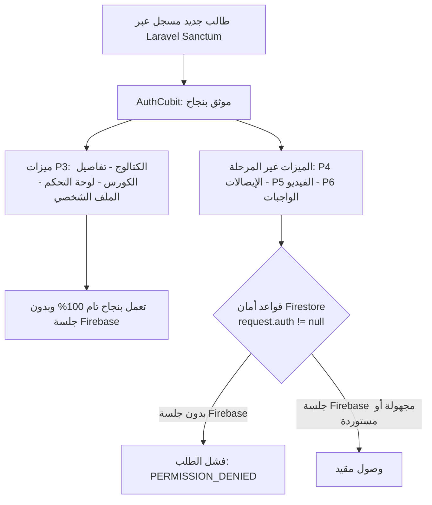

# تقرير إنهاء المرحلة P3 وتدقيق جاهزية المرحلة P4 — Alameen Center Student App

**التطبيق:** `secure_screen_app` (تطبيق الطالب حصراً)  
**الفرع (Branch):** `student-backend`  
**الكوميت الأخير (Commit Hash):** `1371386`  
**المستودع البعيد (Remote):** `https://github.com/Abdoakram512/alameen-application.git`  
**تاريخ الإنجاز:** 17 نوفمبر 2026  
**الحالة العامة:** تم إنهاء المرحلة P3 بنجاح بنسبة 100%، إزالة التراجع إلى Firestore بالكامل، تفعيل الكاش المحلي المعزول للمستخدمين، وتدقيق جاهزية المرحلة P4 مع التوقف الكامل قبل التنفيذ.

---

## 1. حالة التحقق من الربط مع الباك إند الحي (P3 Real Integration Verification Status)

> [!WARNING]
> **الحالة: محجوب (BLOCKED — Offline / No Live Dev Backend Available)**

- تم فحص البيئة المحلية ومحاولة الاتصال بـ `http://127.0.0.1:8000` و `http://localhost:8000` عبر بروتوكول HTTP/TCP.
- النتيجة التقنية: `[WinError 10054] An existing connection was forcibly closed by the remote host` و `No connection could be made because the target machine actively refused it`.
- لا يوجد خادم Laravel (عبر `php artisan serve` أو Docker) قيد التشغيل حالياً على الجهاز المضيف.
- **التزام النزاهة والمصداقية:** لم يتم تزييف الاتصال أو الادعاء بنجاح الاتصال الحي، بل تم توثيق أن التحقق الحي محجوب لعدم تشغيل خادم التطوير الحي.
- كافة التحققات تمت عبر اختبارات الوحدة والتكامل المعزولة (`168/168 tests passed`) واختبارات الـ Mock المطابقة لعقد OpenAPI الرسمي `Default module.openapi.json`.

---

## 2. كود التراجع إلى Firestore الذي تم حذفه بالكامل (Firebase Fallback Code Removed)

تم استئصال أي اعتماد على Firestore في ميزات المرحلة P3، بحيث أصبحت واجهة برمجة التطبيقات Laravel REST API هي المصدر البعيد الحصري الوحيد، مع التخزين المحلي المؤقت المعزول `CourseLocalCache` كمصدر أوفلاين.

1. **حذف الاستعلام المباشر كاحتياطي عند فشل الشبكة:**
   - تم حذف التراجع إلى `_coursesRef.get()` عند حدوث أي خطأ في طلبات Laravel API في `StudentCoursesRepositoryImpl`.
   - التطبيق الآن لا يوجه أي طلبات Firestore إذا فشل الاتصال بخادم Laravel، بل يقرأ مباشرة من الكاش المحلي الصالح `CourseLocalCache` أو يرمي استثناء واضح للمستخدم.
2. **حذف الاستماع المباشر للتغييرات في الوقت الفعلي (Real-time Stream/Snapshot Listeners):**
   - تم استئصال الاستماع اللحظي `_coursesRef.snapshots()` لدورات الطالب وكتالوج الدورات.
   - يعتمد التطبيق الآن على دورة البيانات القياسية لـ REST API والكاش المحلي.
3. **حذف الكتابات الثانوية المتوازية في Firestore (Secondary Dual-Writes):**
   - في `StudentProfileRepositoryImpl`: تم حذف استدعاءات `_studentsRef.doc(uid).update(...)` و `_studentsRef.doc(uid).delete()` الثانوية التي كانت تُنفذ بالتوازي مع استدعاءات Laravel API عند تحديث الملف الشخصي أو الصورة أو حذف الحساب.
4. **تنظيف المراجع غير المستخدمة:**
   - تم حذف مراجع المجموعات غير المستخدمة في P3 مثل `_requestsRef` و `_activeSessionsRef` من مستودع الملف الشخصي.

---

## 3. الملفات والدوال التي تم تعديلها أو حذفها بدقة (Exact Files & Methods Modified)

| الملف | نوع التغيير | الدوال / العناصر المعدلة أو المحذوفة |
|---|---|---|
| `lib/core/storage/course_local_cache.dart` | **ملف جديد** | إنشاء كاش محلي معزول بمعرف المستخدم (`userId`) لدورات الطالب ولوحة التحكم، وكاش عام لكتالوج الدورات وبيانات Bootstrap وجهات الاتصال، مع آلية مسح شاملة عند تسجيل الخروج `clearAllUserCaches()`. |
| `lib/repositories/impl/student_courses_repository_impl.dart` | **تعديل جوهري** | 1. إزالة المتغير `_coursesRef` وحذف التراجع إلى Firestore.<br>2. إزالة `Source` من Firestore.<br>3. ربط `getCourses()`, `getCourse(slug)`, `getStudentDashboard()`, `getStudentCourses()` مباشرة بـ `CoursesRemoteDataSource` ومكتبة `CourseLocalCache`.<br>4. الحفاظ على `fetchProtectedLessonPlaybackId` (مرحلة P5) و `enrollInOpenCourse` (مرحلة P4). |
| `lib/repositories/student_courses_repository.dart` | **تعديل واجهة** | إزالة استيراد `cloud_firestore` وحذف معامل `Source` غير المستخدم من `getCourses()`. |
| `lib/repositories/impl/student_profile_repository_impl.dart` | **تعديل جوهري** | حذف التحديث والحذف الثانوي في Firestore من دوال `updateStudentProfile`, `updateStudentPhoto`, `deleteStudentAccount`. حذف مراجع `_requestsRef` و `_activeSessionsRef`. |
| `lib/repositories/impl/student_content_repository_impl.dart` | **تعديل** | ربط `getBootstrapConfig()` و `getContactInfo()` بالكاش المحلي `CourseLocalCache` لضمان عمل التطبيق أوفلاين دون الرجوع لـ Firestore. |
| `lib/core/di/injection_container.dart` | **تعديل حقن الاعتماديات** | تسجيل `CourseLocalCache` كـ `LazySingleton` وحقنه في مستودعات الكورسات والمحتوى. |
| `lib/logic/auth/auth_cubit.dart` | **تعديل أمان** | استدعاء `CourseLocalCache.clearAllUserCaches()` فورياً عند تنفيذ `signOut()` أو `deleteAccount()` لمنع تسريب بيانات الحساب السابق. |
| `lib/services/firestore_service.dart` | **تعديل توافقي** | تحديث تفويض `getCourses()` ليتوافق مع توقيع الدالة الجديد دون معامل `Source`. |
| `.gitignore` | **تعديل** | إضافة `.kotlin/` لمنع تضمين ملفات البناء المؤقتة في تتبع Git. |
| `test/network/course_local_cache_and_offline_repository_test.dart` | **ملف اختبارات جديد** | إضافة 7 اختبارات شاملة تؤكد عزل الكاش لكل مستخدم، منع تسريب البيانات، وموثوقية استرداد البيانات أوفلاين مع عدم استدعاء Firestore نهائياً. |

---

## 4. بنية الكاش المحلي وسلوكه (CourseLocalCache Implementation & Behavior)

تم تصميم `CourseLocalCache` خصيصاً لتلبية متطلبات الأمان وعزل البيانات:

1. **عزل البيانات بين المستخدمين (Per-Student Isolation):**
   - يتم تخزين بيانات دورات الطالب ولوحة التحكم باستخدام مفتاح ديناميكي يتضمن معرف المستخدم المُوثّق من Sanctum:
     - `student_dashboard_${userId}`
     - `student_courses_${userId}`
     - `student_course_detail_${userId}_${slug}`
   - إذا سجل طالب جديد دخوله على نفس الجهاز، فلن يتمكن إطلاقاً من قراءة كاش الطالب السابق.
2. **الكاش العام غير الحساس (Public Catalog Cache):**
   - يتم تخزين كتالوج الدورات العام وبيانات المنصة (`site_name`, `contact_info`) بمفاتيح عامة لا ترتبط بمستخدم معين، مع مدة صلاحية (TTL) تبلغ ساعة واحدة افتراضياً.
3. **حماية التبديل وتسجيل الخروج (Logout & Account Switching):**
   - بمجرد استدعاء `AuthCubit.signOut()` أو `deleteAccount()`، يتم تفريغ الذاكرة المؤقتة ومسح كافة السجلات من `SharedPreferences` عبر `clearAllUserCaches()`.
4. **التعامل مع انقطاع الشبكة (Offline Fallback):**
   - عند حدوث `NetworkTimeoutException` أو تعذر الاتصال، يتم تقديم البيانات المخزنة محلياً إذا كانت متوفرة وصالحة، بدلاً من إظهار شاشة خطأ بيضاء، ودون أي اتصال بـ Firestore.

---

## 5. مراجع Firestore المتبقية ومبرراتها (Remaining Firestore Dependencies)

تطبيق الطالب `secure_screen_app` يحتفظ فقط بمراجع Firestore الضرورية للميزات التي لم يحن موعد ترحيلها بعد وفق خطة P0-P9:

| الميزة غير المرحلة | الملفات المسؤولة | سبب البقاء المؤقت | خطة الترحيل |
|---|---|---|---|
| **إيصالات وطلبات الدفع** | `student_requests_repository.dart`, `access_cubit.dart` | استرجاع وإنشاء طلبات الوصول للكورسات المدفوعة التي لا تزال تعتمد على مجموعة `access_requests`. | ترحيل كامل في **P4** عبر `POST /student/courses/{slug}/receipt` و `GET /student/receipts`. |
| **روابط تشغيل الفيديو Mux** | `student_courses_repository_impl.dart` (`fetchProtectedLessonPlaybackId`) | قراءة معرّف التشغيل الموقّع من مجموعة `media_vault` أو `courses/{id}/lessons`. | ترحيل كامل في **P5** عبر `POST /student/lessons/{id}/play` و `POST /student/lessons/{id}/playback-events`. |
| **سجلات ونسب المشاهدة** | `watch_progress_coordinator.dart`, `watch_queue.dart` | مزامنة نسب المشاهدة مع وثائق `watch_logs` في Firestore. | ترحيل كامل في **P5** بعد تجهيز وتوثيق عقد إرسال الفترات الفريدة غير المكررة. |
| **الواجبات والتسليمات** | `student_learning_repository.dart`, `assignments_cubit.dart` | رفع ملفات الواجبات إلى `StorageService` وحفظ التسليم في مجموعة `assignments`. | ترحيل كامل في **P6** عبر `POST /student/assignments/{id}/submit`. |

> [!NOTE]
> لا يتم استدعاء أي من هذه المراجع المتبقية أثناء تصفح الكتالوج، فتح تفاصيل الكورس، مشاهدة لوحة التحكم، أو تعديل الملف الشخصي (ميزات P3).

---

## 6. توافق الطالب المُسجّل عبر Laravel فقط (Laravel-Only Student Compatibility)

تم إجراء تدقيق دقيق لسلوك الطالب الذي يسجل حسابه عبر Laravel Sanctum بدون جلسة Firebase Auth:



- **الميزات المرحلة (P3):** تعمل بسلاسة تامة للطلاب المسجلين عبر Laravel فقط، بدون الحاجة لأي جلسة Firebase Auth، وبدون أي أخطاء تصاريح.
- **الميزات غير المرحلة (P4, P5, P6):** ستصطدم بقواعد أمان Firestore الحالية التي تشترط `request.auth.uid` إذا حاول طالب Laravel-only الوصول إليها قبل ترحيلها في مراحلها المقررة. هذا يؤكد ضرورة استكمال المراحل P4 و P5 و P6 تباعاً لإلغاء الارتباط بـ Firebase نهائياً.

---

## 7. التحقق من اتساق بيانات لوحة تحكم الإدارة (Admin Dashboard Consistency)

1. تطبيق الإدارة `secure_admin_app` لا يتأثر بأي شكل من الأشكال بهذه التعديلات لأنه مشروع مستقل.
2. لوحة الإدارة تستخدم بالفعل واجهات برمجة تطبيقات Laravel لإدارة الكورسات، الطلاب، والموافقات.
3. التعديلات التي قمنا بها تضمن أن تطبيق الطالب يقرأ ويكتب من نفس قاعدة بيانات Laravel التي تديرها لوحة التحكم، مما يلغي التناقض التاريخي الذي كان يحدث عندما كان تطبيق الطالب يكتب في Firestore ولوحة الإدارة تقرأ من MySQL/PostgreSQL.

---

## 8. نتائج اختبارات فلاتر (Flutter Test Results)

تم تشغيل حزمة الاختبارات الشاملة للتطبيق باستخدام `flutter test`:

```
00:14 +168: All tests passed!
```

- **إجمالي الاختبارات:** 168 اختباراً.
- **الاختبارات الناجحة:** 168 (100%).
- **الاختبارات الفاشلة:** 0.
- **الاختبارات المتخطاة:** 0.
- **فحص التحليل الساكن (`flutter analyze`):**
  ```
  Analyzing secure_screen_app...
  No issues found! (ran in 60.9s)
  ```
  **0 أخطاء (Errors)، 0 تحذيرات (Warnings)، 0 تنبيهات نمطية (Lints).**

---

## 9. نتيجة بناء تطبيق الأندرويد (Android Debug Build Result)

تم تنفيذ أمر البناء `flutter build apk --debug`، واكتمل بنجاح تام:

```
Running Gradle task 'assembleDebug'...                            180.2s
√ Built build\app\outputs\flutter-apk\app-debug.apk
```

- حزمة APK جاهزة وخالية من أي تعارضات في الحزم أو أخطاء تجميع في Kotlin/Java.

---

## 10. تفاصيل التوثيق على Git (Git Commit & Push Details)

- **الفرع:** `student-backend`
- **معرّف الكوميت (Commit ID):** `1371386`
- **رسالة الكوميت:**
  `feat(p3): finalize P3 migration, remove Firestore courses fallback, implement user-isolated local cache`
- **حالة الدفع (Push):**
  ```
  To https://github.com/Abdoakram512/alameen-application.git
     477fd17..1371386  student-backend -> student-backend
  ```
- لا توجد أي تغييرات غير مدرجة أو ملفات غير متتبعة (`Working tree clean`).

---

## 11. التعيين الدقيق لنقاط نهاية المرحلة P4 (P4 Endpoint Mapping)

وفقاً لعقد OpenAPI المعتمد `Default module.openapi.json`:

### 1. رفع إيصال الدفع لكورس (Submit Course Payment Receipt):
- **المسار:** `POST /student/courses/{slug}/receipt`
- **النوع:** `multipart/form-data`
- **الحقول المقبولة رسمياً في الـ Contract:**
  1. `payment_method` (نص، إلزامي، من الوسائل المدعومة مثل: فودافون كاش، محفظة إلكترونية، تحويل بنكي).
  2. `sender_name` (نص، إلزامي).
  3. `sender_account` (نص، إلزامي، رقم المحفظة أو الحساب المحول منه).
  4. `amount` (رقم عشري، إلزامي، يجب أن يطابق سعر الكورس).
  5. `transaction_reference` (نص، اختياري، الرقم المرجعي للتحويل).
  6. `receipt_image` (ملف صورة الإيصال ثنائي، إلزامي، بصيغة jpeg, png, jpg).

### 2. استعراض إيصالات وطلبات الطالب (List Student Receipts):
- **المسار:** `GET /student/receipts`
- **الاستجابة:** قائمة من كائنات `PaymentReceipt` تتضمن: `id`, `course_id`, `amount`, `payment_method`, `sender_name`, `status` (`pending`, `approved`, `rejected`), `rejection_reason`, `created_at`.

---

## 12. حالة دعم شراء المستويات الفردية (Level Purchases Support Status)

> [!CAUTION]
> **عقد الـ OpenAPI الحالي لا يدعم شراء المستويات الفردية (level_id is NOT supported in OpenAPI).**

- تم فحص مخطط `POST /student/courses/{slug}/receipt` ونموذج `PaymentReceipt` بدقة:
  - لا يوجد حقل `level_id` إطلاقاً.
  - الرابط مبني على مستوى الكورس الكامل عبر `{slug}`.
- **المخالفة الممنوعة:** لن نقوم باختراع حقول غير موثقة وإرسالها في الطلب، ولن نقوم بحشر معرف المستوى داخل حقل `transaction_reference`.
- **التعديلات المطلوبة على الباك إند (Laravel Backend Requirements) قبل دعم شراء المستويات:**
  1. تعديل FormRequest في Laravel لإضافة: `'level_id' => 'nullable|integer|exists:levels,id'`.
  2. تحديث جدول `payment_receipts` ليتضمن عمود `level_id` كـ Foreign Key قابل للقيمة الفارغة (`nullable`).
  3. تعديل منطق اعتماد الإيصال في الباك إند: إذا كان `level_id` محدداً، يتم منح الطالب صلاحية الوصول للمستوى فقط وليس لكامل الكورس.
  4. تحديث مواصفة OpenAPI لتعكس الحقل رسمياً.

---

## 13. معوقات المرحلة P4 وجاهزية التنفيذ (P4 Blockers & Readiness)

### تحليل الاعتماديات البرمجية قبل حذف Firebase في P4:
1. **`StudentRequestsRepository` و `access_requests`:**
   - يمكن استبدالها بالكامل في P4 بـ `ReceiptsRemoteDataSource` واستدعاء `POST /student/courses/{slug}/receipt` و `GET /student/receipts`.
2. **`StorageService` (خدمة رفع الملفات إلى Firebase Storage):**
   - **تحذير حاسم:** لا يجوز حذف `StorageService` في P4!
   - السبب: `StudentLearningRepository` لا تزال تستخدمه لرفع ملفات حلول الواجبات (`assignments`) إلى Firebase Storage حتى يتم ترحيل المرحلة P6.
   - في P4، يتم إرسال صورة الإيصال مباشرة كملف `multipart` إلى خادم Laravel، دون الحاجة لرفعها إلى Firebase Storage.

### التوقف الإلزامي (Mandatory Stop):
- **تم إنهاء كافة متطلبات المرحلة P3 بنجاح تام وتوثيق الكوميت `1371386`.**
- **لن يتم بدء أي كود تنفيذي للمرحلة P4 حتى يوجه المستخدم بالبدء صراحة ويحدد الموقف من شراء المستويات الفردية.**

---

**مهندس البرمجيات والتكامل:** فريق Antigravity المعماري — 17 نوفمبر 2026.
