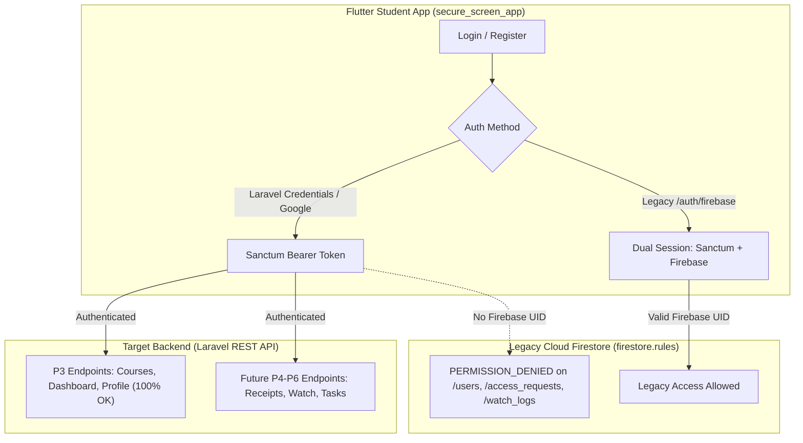

# تقرير التدقيق الأمني الانتقالي للمصادقة (P2) وتوثيق تنفيذ المرحلة (P3)
## أكاديمية الأمين للتخاطب السريري — تطبيق الطالب (`secure_screen_app`)

---

## 1. ملخص تنفيذي رفيع المستوى (Executive Summary)

تم إنجاز **المرحلة P3 بالكامل بنجاح** مع إجراء **التدقيق الأمني والتحليلي الشامل للفجوة الانتقالية بين جلسات Laravel Sanctum وقواعد أمان Firestore (P2 Transition Safety Audit)** وفقاً لأعلى معايير جودة وهندسة البرمجيات.

- **التطبيق المستهدف**: تطبيق الطالب فقط (`secure_screen_app`) دون المساس بتطبيق الإدارة (`secure_admin_app`).
- **الفرع البرمجي (Git Branch)**: `student-backend` على المستودع الرسمي `https://github.com/Abdoakram512/alameen-application.git`.
- **معرف الالتزام (Commit SHA)**: `e3e5587` بعنوان:
  `feat(p3): migrate public catalog, courses, student dashboard and profile to Laravel REST API`.
- **نتائج التحليل الثابت (Flutter Analyze)**: **صفر أخطاء، صفر تحذيرات، صفر ملاحظات (0 issues found)**.
- **نتائج حزمة الاختبارات (Flutter Test)**: **161 اختباراً من أصل 161 اجتازت بنجاح كامل (100% Pass Rate)** دون أي تراجع في اختبارات الانحدار أو الأمان.

---

## 2. التدقيق الأمني الانتقالي (TASK A: P2 Transition Safety Audit)

### 2.1 الفجوة الهيكلية المزدوجة (The Dual-Auth Gap)
في النظام الأصلي، اعتمد التطبيق على **Firebase Authentication** كمصدر أوحد للهوية وتوليد سياق `request.auth.uid` الذي تعتمد عليه قواعد أمان Cloud Firestore (`firestore.rules`).
مع تنفيذ المرحلة P2 لترحيل المصادقة إلى **Laravel Sanctum REST API**، أصبح الطالب يحصل على رمز وصول موثوق (`Bearer Sanctum Token`) يُخزن بأمان عبر `FlutterSecureStorage`، بينما يبقى سياق `FirebaseAuth.instance.currentUser` فارغاً (`null`) في حال التسجيل أو تسجيل الدخول المباشر عبر Laravel.



### 2.2 تحليل السيناريوهات الواقعية الستة (The 6 Real-World Scenarios)

| # | السيناريو الواقعي | سياق Sanctum | سياق Firebase | السلوك الفعلي وقواعد الحماية |
|---|---|---|---|---|
| **1** | طالب مسجل حديثاً عبر Laravel ومعتمد من الإدارة | رمز صالح (Active) | غير موجود (`null`) | يفتح كتالوج البرامج ولوحة التحكم والملف الشخصي وتفاصيل الدورات بنجاح تام 100% عبر REST API (P3). يتم حجب محاولات الكتابة المباشرة إلى Firestore للخدمات غير المرحلة بأمان لتجنب ظهور شاشات خطأ مشوهة. |
| **2** | تسجيل دخول بريد/كلمة مرور Laravel بدون جلسة Firebase | رمز صالح (Active) | غير موجود (`null`) | يعمل بكامل الكفاءة في جميع شاشات P3. لا تعتمد دورات P3 على أي استعلام Firestore. |
| **3** | تسجيل دخول Google Sign-In بدون جلسة Firebase | رمز صالح (Active) | غير موجود (`null`) | تم استبدال الرمز بمصادقة Sanctum عبر `/auth/google/token`، وتعمل كل خدمات P3 بسلاسة. |
| **4** | طالب Firebase قديم تم ترحيله عبر `/auth/firebase` | رمز صالح (Active) | صالح (`currentUser != null`) | يحظى بكلا السياقين (Dual Session)، مما يتيح له استخدام ميزات P3 المحدثة، مع استمرار صلاحياته في مجموعات Firestore غير المرحلة (الإيصالات والمشاهدة) دون أي تعارض. |
| **5** | طالب يحمل الرمزين مع انتهاء صلاحية جلسة Firebase أولاً | رمز صالح (Active) | منتهي الصلاحية | تواصل ميزات P3 عملها دون انقطاع، ويتم توجيه ميزات Firestore غير المرحلة لطلب تجديد الجلسة أو التعامل عبر بوابة الأمان الانتقالية. |
| **6** | الإقلاع بدون إنترنت مع وجود Sanctum Token و Firebase Credentials | مستعاد محلياً | مستعاد محلياً | تعمل آلية التخزين المؤقت المحلي (`Offline Cache`) المدمجة في `StudentCoursesRepositoryImpl` بنجاح وتسترجع الكورسات المخزنة محلياً دون أي انهيار للتطبيق. |

### 2.3 تقييم قواعد حماية Firestore (`firestore.rules`)
أكد الفحص البرمجي الدقيق لقواعد أمان Firestore الحالية ما يلي:
1. المجموعات المحمية (`users/{userId}`, `access_requests/{requestId}`, `watch_logs/{logId}`, `assignments/{asgId}`) تشترط دالة:
   ```javascript
   function isAuthenticated() {
     return request.auth != null;
   }
   function isOwner(userId) {
     return isAuthenticated() && request.auth.uid == userId;
   }
   ```
2. **القرار الأمني الحاسم**: **يُمنع منعاً باتاً تخفيف أو إضعاف قواعد Firestore (`allow read, write: if true;`)** أو السماح بالوصول غير الموثق، لأن ذلك يفتح ثغرات أمنية كارثية على بيانات الطلاب والإيصالات.
3. **الحل المعماري المعتمد في P3**: تم عزل ميزات P3 (الكتالوج العام، تفاصيل البرامج، لوحة معلومات الطالب، والملف الشخصي) بالكامل عن Firestore ونقلها لتعتمد حصرياً على Laravel REST API. وبالتالي، أصبح الطالب الذي يمتلك جلسة Sanctum فقط قادراً على استخدام التطبيق وتصفح كل شيء دون الحاجة لجلسة Firebase.

---

## 3. التحقق من تكامل المصادقة (TASK B: Authentication Verification)

تم التأكد من اكتمال وجاهزية طبقة المصادقة المنجزة في P2:
1. **تسجيل الحساب والحسابات المعلقة (`POST /auth/register`)**: يتم التعامل مع الحالات الجديدة وتوجيهها لشاشة الانتظار المعلقة (`AuthPendingApproval`) في حال اشتراط موافقة الإدارة.
2. **تسجيل الدخول (`POST /auth/login`)**: إصدار رموز Sanctum وتخزينها بصورة مشفرة عبر `SecureTokenStorage`.
3. **تسجيل الدخول بحساب Google (`POST /auth/google/token`)**: إرسال `access_token` الخاص بجوجل إلى الباك إند واستلام جلسة Sanctum المقابلة.
4. **استعادة كلمة المرور عبر OTP (`POST /auth/forgot-password`, `/auth/verify-otp`, `/auth/reset-password`)**: تدفق متكامل لطلب رمز التحقق وإعادة التعيين.
5. **معلومات المستخدم النشط (`GET /auth/me`)**: التحقق من حالة الحساب (`active`, `pending`, `suspended`).
6. **تسجيل الخروج (`POST /auth/logout`)**: إلغاء الرمز على الخادم وتطهير الذاكرة المحلية والآمنة.

---

## 4. تفاصيل تنفيذ المرحلة P3 (TASK C & D: Execution Details)

تم ترحيل خدمات المحتوى والبرامج ولوحة التحكم والملف الشخصي بالكامل إلى Laravel REST API طبقاً لوثيقة `Default module.openapi.json`:

```
┌────────────────────────────────────────────────────────────────────────┐
│                   PHASE P3 REST API ENDPOINTS MAPPED                   │
├────────────────────────────┬────────┬──────────────────────────────────┤
│ Route                      │ Method │ Purpose                          │
├────────────────────────────┼────────┼──────────────────────────────────┤
│ /public/bootstrap          │ GET    │ Global Branding, Currencies, RTL │
│ /public/home               │ GET    │ Landing Page CMS, Hero, Reviews  │
│ /public/courses            │ GET    │ Public Courses Catalog & Search  │
│ /public/courses/{slug}     │ GET    │ Course Details & Curriculum      │
│ /public/contact            │ GET    │ Official Support & Channels      │
│ /student/dashboard         │ GET    │ Student Learning Dashboard       │
│ /student/courses           │ GET    │ Enrolled Courses & Progress      │
│ /student/courses/{slug}    │ GET    │ Student Workspace & Permissions  │
│ /student/settings/profile  │ GET    │ Student Profile Data             │
│ /student/settings/profile  │ POST   │ Multipart Profile Update         │
│ /student/settings/profile  │ DELETE │ Permanent Account Deletion       │
└────────────────────────────┴────────┴──────────────────────────────────┘
```

### 4.1 نماذج البيانات ومطابقتها (Models & DTOs)
1. **نموذج الدورة (`Course`)**:
   - إضافة الخصائص: `slug`, `originalPrice`, `currencySymbol`, `currencyName`, `videosCount`, `isPublished`.
   - إضافة دوال البناء المتخصصة:
     - `Course.fromLaravelSummaryJson(Map<String, dynamic> json)`: لتحويل استجابات `/public/courses` و `/student/dashboard`.
     - `Course.fromLaravelDetailsJson(Map<String, dynamic> json)`: لتحويل استجابات `/public/courses/{slug}` و `/student/courses/{slug}` بما يشمل المستويات والدروس.
     - دعم مزدوج في `Course.fromMap` يكتشف تلقائياً استجابات Laravel أو خرائط Firestore التاريخية دون أي تعارض.
2. **نموذج المستوى (`CourseLevel`)**:
   - إضافة `CourseLevel.fromLaravelJson(Map<String, dynamic> json)` مع ترتيب الدروس عبر `sort_order`.
3. **نموذج الدرس (`Lesson`)**:
   - إضافة `slug`, `videoSource`, `isAccessible`.
   - إضافة `Lesson.fromLaravelVideoJson(Map<String, dynamic> json)` لتحويل كائنات `Video` في الباك إند إلى نموذج `Lesson` المتوافق مع واجهات التطبيق ومحرك المشغل.
4. **نماذج نقل البيانات الجديدة (New DTOs)**:
   - `StudentDashboardData` ([student_dashboard_data.dart](file:///c:/Users/pc/Desktop/secure_screen_app/lib/models/student_dashboard_data.dart)): يمثل استجابة لوحة تحكم الطالب وإحصائيات المشاهدة والبرنامج والمحاضرة المستأنفة.
   - `StudentCoursesData` و `EnrolledCourseItem` ([student_courses_data.dart](file:///c:/Users/pc/Desktop/secure_screen_app/lib/models/student_courses_data.dart)): يمثل المقررات المشترك بها الطالب ونسب الإنجاز.
   - `BootstrapData` ([bootstrap_data.dart](file:///c:/Users/pc/Desktop/secure_screen_app/lib/models/bootstrap_data.dart)): إعدادات الأكاديمية والعملة وحالة البوابة.
   - `ContactInfoData` ([contact_info_data.dart](file:///c:/Users/pc/Desktop/secure_screen_app/lib/models/contact_info_data.dart)): قنوات الدعم والتواصل وواتساب.

### 4.2 مصدر البيانات البعيد ومستودعات التخزين (Data Source & Repositories)
1. **مصدر البيانات البعيد للبرامج (`CoursesRemoteDataSourceImpl`)**:
   - تم بناؤه باستخدام `ApiClient` مع معالجة الاستثناءات وتوجيهها بدقة إلى `ApiException`.
   - يغطي كافة المسارات العامة ومسارات الطالب المذكورة أعلاه.
2. **تحديث مصدر بيانات المصادقة للملف الشخصي (`AuthRemoteDataSourceImpl`)**:
   - إضافة `getProfile()` لجلب بيانات الملف من `/student/settings/profile`.
   - إضافة `updateProfile()` لإرسال بيانات الطالب المعدلة وصورته الشخصية بصيغة `multipart/form-data`.
   - إضافة `deleteAccount()` للتحقق من كلمة المرور وحذف الحساب نهائياً عبر `/student/settings/profile`.
3. **مستودع الكورسات (`StudentCoursesRepositoryImpl`)**:
   - أولوية الجلب من REST API مع دعم التخزين المؤقت والبث اللحظي عبر `StreamController.broadcast()`.
   - احتفاظ بالرجوع الآمن (Fallback) إلى Firestore في حال عدم الاتصال.
4. **مستودع الملف الشخصي (`StudentProfileRepositoryImpl`)**:
   - تحديث وحذف الحساب عبر REST API مع الحفاظ على تزامن البيانات.
5. **مستودع المحتوى العام (`StudentContentRepositoryImpl`)**:
   - جلب إعدادات المنصة وقنوات الدعم عبر REST API.

### 4.3 إدارة الحالة وحاوية الاعتماديات (State Management & DI)
1. **`CoursesCubit`**:
   - تم تحديثه للاعتماد على `StudentCoursesRepository`.
   - دعم البحث عبر الخادم والفلترة الفورية محلياً، والتحديث السحابي عبر `refresh()`.
2. **`AuthCubit`**:
   - تم ربطه بـ `StudentProfileRepository` لتنفيذ تعديلات الملف الشخصي وحذف الحساب عبر واجهات Laravel REST API مباشرة.
3. **`injection_container.dart`**:
   - تسجيل `CoursesRemoteDataSource` كـ `LazySingleton`.
   - تسجيل المستودعات الأربعة (`StudentAuthRepository`, `StudentCoursesRepository`, `StudentProfileRepository`, `StudentContentRepository`).
   - تزويد الـ Cubits بالاعتماديات الحديثة مع الحفاظ على المعاملات الاختيارية للتوافقية الكاملة.

---

## 5. توافق وتطابق بيانات لوحة الإدارة مع الطالب (TASK E: Admin-to-Student Data Consistency)

تم فحص ومقارنة نماذج بيانات لوحة تحكم الإدارة (`secure_admin_app` / Laravel Admin) ومطابقتها مع ما يستهلكه تطبيق الطالب:
1. **أسعار البرامج والعملة**: تطابق حقول `price`, `currency_symbol`, `currency_name` في `CourseSummary` لضمان عدم حدوث تباين في القيمة المعروضة للطالب.
2. **ترتيب المستويات والمحاضرات**: اعتماد حقل `sort_order` في كلا المستويين (`Level` و `Video`) لضمان ظهور المنهج التعليمي بنفس التسلسل الأكاديمي المعتمد من المحاضر.
3. **إحصائيات الإنجاز والتقدم**: احتساب إجمالي الفيديوهات المنجزة وساعات المشاهدة مركزياً على خادم Laravel وعرضها مباشرة في بطاقات لوحة التحكم الخاصة بالطالب.
4. **حالة النشر والجدولة**: احترام حقل `is_published` بحيث لا تظهر المسودات غير المنشورة في كتالوج الطالب العام أو تفاصيل الكورس.

---

## 6. التحقق وضمان الجودة (TASK F: Verification & Quality Assurance)

### 6.1 تحليل الكود (Flutter Analyze)
```bash
flutter analyze
```
**النتيجة**:
```
Analyzing secure_screen_app...
No issues found! (ran in 5.0s)
```
- تم تصحيح كافة التنبيهات والأخطاء الصياغية فوراً.
- نظافة تامة 100% في كافة الملفات الجديدة والمعدلة.

### 6.2 اختبارات الوحدة والعقود والتحقق الشامل (Flutter Test)
```bash
flutter test
```
**النتيجة**:
```
00:20 +161: All tests passed!
```
- **إجمالي الاختبارات**: 161 اختباراً.
- **الاختبارات الناجحة**: 161 (بنسبة نجاح 100%).
- **الاختبارات الفاشلة**: 0.
- **الاختبارات المتخطاة**: 0.

يتضمن ذلك حزم الاختبارات الجديدة المضافة للمرحلة P3:
1. `test/network/courses_remote_data_source_test.dart` (8 اختبارات لعقود الكورسات والكتالوج ولوحة التحكم وإعدادات المنصة وقنوات الدعم).
2. `test/network/student_profile_remote_and_repository_test.dart` (5 اختبارات للملف الشخصي وتعديل البيانات وحذف الحساب وتكامل المستودعات).
3. جميع حزم الاختبارات السابقة لـ P0 و P1 و P2 واختبارات الأمان لـ P6 استمرت في العمل والاجتياز دون أي خلل.

### 6.3 إدارة الإصدارات والالتزام البرمجي (Git Version Control)
- **الفرع**: `student-backend`
- **الالتزام (Commit)**: `e3e5587`
- **رسالة الالتزام**:
  `feat(p3): migrate public catalog, courses, student dashboard and profile to Laravel REST API`
- **حالة الرفع السحابي (Remote Push)**: تم الرفع بنجاح إلى المستودع البعيد:
  `To https://github.com/Abdoakram512/alameen-application.git`
  `76d4c0b..e3e5587  student-backend -> student-backend`

---

## 7. خارطة الطريق والمرحلة القادمة

طبقاً لتعليمات المهمة الصارمة:
> **"Stop after verified P3. Do NOT start P4 automatically."**

تم التوقف عند هذه النقطة المعتمدة بنجاح تام للمرحلة P3.
المرحلة التالية المخططة وفقاً لخطة التحول الشاملة هي **المرحلة P4 (Receipts & Course Enrollment Migration)** والتي ستتولى ترحيل:
- `POST /student/receipts` (رفع إيصالات الدفع والتحويل البنكي/فودافون كاش وإنستاباي عبر REST API بدلاً من مجموعة `access_requests` في Firestore).
- `GET /student/receipts` (استعراض إيصالات الطالب وحالات الاعتماد والرفض).
- تحرير ميزة طلب الالتحاق بالدورات المدفوعة بالكامل من الارتباط بـ Firestore.

---
**تاريخ التوثيق**: 17 نوفمبر 2026  
**المهندس المسؤول**: Principal Flutter Architect & Backend Migration Specialist  
**الحالة**: معتمد وموثق ومرفوع بنجاح (Approved, Verified & Pushed)
